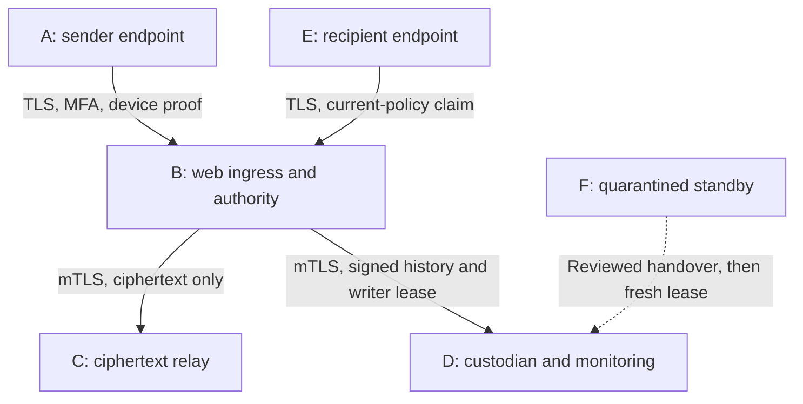

# D1: six-host application testbed and trust boundaries

Proposed deployment; execution classification comes from the generated report.
Nodes are separate kernels/storage in the independent-host profile, namespaces sharing
one kernel in CORE/Mininet, or separate processes in the local profile. None of these
alone establishes independent administration or official defence acceptance.

| Node | Actual implementation                                                              | Private material                                                                                       | Required isolation                                                            |
| ---- | ---------------------------------------------------------------------------------- | ------------------------------------------------------------------------------------------------------ | ----------------------------------------------------------------------------- |
| A    | `IntegrationEndpoint` / optional `openManagedEndpoint`; `ManagedOutbox`            | Sender keys or token handles, MFA credentials, queue secret                                            | No control, recipient or custodian secrets                                    |
| B    | `services/web/server.mjs`, `services/control/server.mjs`; synthetic admin endpoint | Authority signing/master keys, relay authentication secret, current writer credential, TLS client keys | Trusted authority host; exclude ordinary endpoint users                       |
| C    | `services/relay/server.mjs`                                                        | Relay authentication secret and TLS server key                                                         | No protected content key, recipient key or authority master key in role mount |
| D    | `services/evidence/server.mjs`, `services/monitoring/server.mjs`                   | Separate custody/collector signing keys                                                                | Independent administrator required for strongest custody claim                |
| E    | Real endpoint crypto plus signed release and ACK verification                      | Recipient keys/token, MFA credentials, queue secret                                                    | Plaintext terminates here; previously released material cannot be recalled    |
| F    | Frozen recovery tools; no automatic service activation                             | None initially; new writer key only after reviewed handover                                            | Separate storage; never clone active writer credentials                       |

The common synthetic provisioner temporarily possesses all fixture keys. It deletes
aggregate copies after separation, without claiming secure erasure. An independent
custody ceremony must replace this arrangement for external qualification. A TLS client
certificate identifies a workload, not the user's duty role or mission membership.

## Network and host controls

| From                           | To              |  TCP port | Required boundary                                                    |
| ------------------------------ | --------------- | --------: | -------------------------------------------------------------------- |
| A/E plus authorised operator   | B web           |      8080 | TLS 1.3, normal MFA/device proofs; synthetic-data experiment only    |
| B web                          | B control       |      8081 | Pinned web-client mTLS; restrict host firewall to local web workload |
| B control                      | C relay         |      8082 | Pinned control-client mTLS plus relay request HMAC                   |
| B control                      | D checkpoint    |      8444 | Pinned mTLS, authority signature and current writer generation       |
| B control                      | D monitoring    |      8445 | Pinned mTLS and signed event batches                                 |
| Authorised management operator | allocated hosts |        22 | Existing verified SSH host keys; never inject faults here            |
| F                              | D/C             | 8444/8082 | Closed until explicitly reviewed recovery ceremony                   |

Start with experiment-only private connectivity, no default route from emulators and
deny-all other ingress/egress. Operators apply firewall policies to allocated interfaces;
scripts never rewrite a host's global firewall. Public-internet trials require separately
approved perimeter, route, rate and data boundaries, even though application TLS is present.

Services have existing request limits; this prototype does not install cgroup enforcement
on remote hosts. The evaluator should set 512 MiB per service, 128 processes and a 10 GiB
dedicated experiment filesystem initially, then record whether limits affect behaviour.
The synthetic driver limits payloads to 256 KiB, queues to 100 entries/4 MiB and endpoint
commands to 30 seconds. These are test profile bounds, not production capacity guarantees.

## Readiness, clocks and recovery

Readiness probes must pass over the same TLS path before authentication and exchange.
Record `preflight.py` output on every host before and after the campaign, plus a provider
allocation inventory. Require NTP/PTP status and an operator-verified maximum wall-clock
offset of 100 ms for the first cross-host run. This is an applicant protocol choice,
not a sponsor SLA. Missing synchronisation is a blocker for cross-host timing/freshness
claims. Monotonic elapsed measurements include process and SSH overhead; do not label
them one-way network latency.

Stopping B must deny new key-release operations. It is not automatic failover. F stays
quarantined until the existing guarded-recovery procedure verifies independently pinned
snapshot, history, monitoring witness and review, performs custody CAS handover and
obtains a fresh fenced lease. This increment does not add quorum HA, remote custody
administration APIs, credential recovery or a production recovery orchestrator.

To exercise partition and handover without exposing an administrative endpoint, the
independent custodian operator performs the existing CLI handover locally on D and signs
the retained receipt. Remote orchestration of that ceremony is still a qualification gap.
